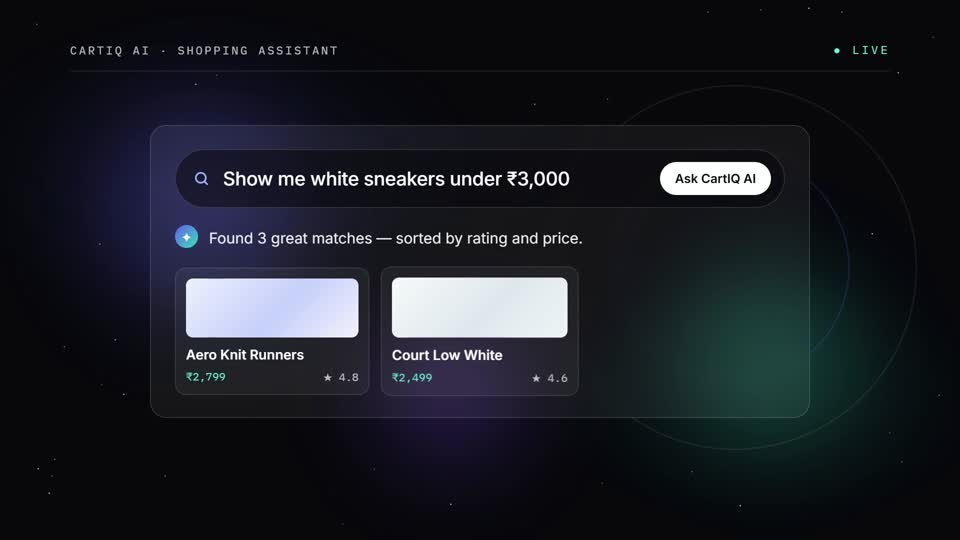
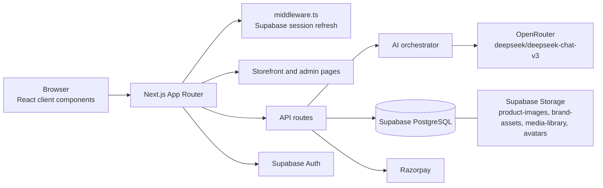
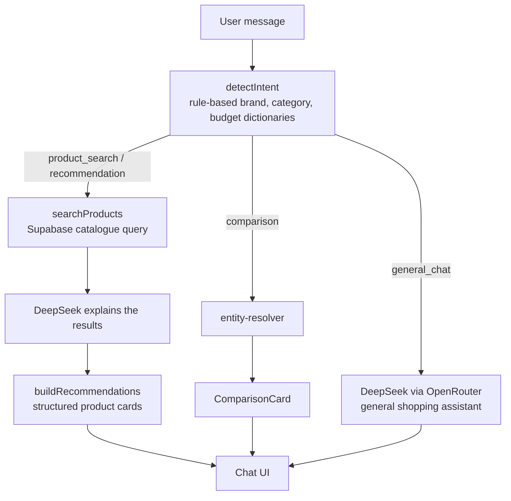

# CartIQ

**An AI-integrated shopping platform where customers describe what they want and the catalogue answers back.**

[Live Demo](https://ai-integrated-personalized-shopping-platform-ium5921jz.vercel.app/) · [Source Code](https://github.com/Crusty-chirayu/AI-integrated-Personalized-shopping-platform-) · [Demo Video](./brag-output/brag.mp4)

---

## Product Demo

[](./brag-output/brag.mp4)

*A 20-second promotional walkthrough of the storefront and the AI shopping assistant. Click the preview to open the video.*

---

## Overview

CartIQ is a full-stack e-commerce application built on Next.js and Supabase. It pairs a conventional storefront (catalogue, cart, checkout, orders, and an admin dashboard) with a conversational shopping assistant. The assistant classifies each message with rule-based intent detection, queries the product catalogue in Supabase, and uses DeepSeek Chat V3 through OpenRouter to write the reply.

The result is a shopping experience where a customer can type "white sneakers under ₹3,000" and receive matching products from the live catalogue, rather than navigating filter panels.

---

## Features

### Storefront

| Area | What is implemented |
|---|---|
| Catalogue | Product listing and detail pages by slug, plus a categories page |
| Search | Search modal backed by `/api/search`, matching product titles and descriptions and category names |
| Cart | Cart state persisted in `localStorage` |
| Wishlist | Wishlist context with `localStorage` and a wishlist service layer |
| Compare | Side-by-side comparison page with a comparison card and verdict logic |
| Checkout | Razorpay order creation, payment confirmation, and a signed webhook handler |
| Orders | Order history and order detail pages scoped to the signed-in user, with PDF output via jsPDF |
| Accounts | Sign-in with email and password, plus Google and GitHub OAuth |

### AI Shopping Assistant

| Capability | Implementation |
|---|---|
| Conversational search | Natural-language queries routed to catalogue search |
| Product recommendations | `recommendation-engine` builds product cards from retrieved results |
| Follow-up context | Last category, brand, budget, and selected product are kept per session |
| Product comparison | Triggered when two or more products are resolved from the conversation |
| Add to cart from chat | Cart handler runs when a product is selected and the plan requests it |
| Voice input | Browser Speech Recognition API through the chat window's microphone button |
| Saved conversations | Signed-in users' conversations and messages are stored in Supabase |
| Preference memory | Brand, category, and budget preferences are saved to `user_preferences` |
| Product-page assistant | A separate `/api/ai/product-chat` endpoint returns structured JSON (title, summary, highlights, recommendation) for a given product |

### Admin

| Area | What is implemented |
|---|---|
| Dashboard | Overview page with charts (Recharts) |
| Products | Create, edit, and delete products, with image upload |
| Orders | Order listing with fulfilment status |
| Customers | Customer listing |
| Reports | Sales, orders, customers, and inventory reports exported as PDF or XLSX |
| Other | Analytics, media library, SEO, and settings pages |

---

## Architecture



### AI Pipeline



Deterministic logic decides *what* to do: intent detection, product retrieval, and follow-up context all run without a model. The language model is used for *how to say it*: explaining search results and answering general shopping questions. Product data always comes from the database, so the model is given retrieved products rather than being asked to recall them.

---

## Technology Stack

| Layer | Technology | Purpose |
|---|---|---|
| Framework | Next.js 16.2 (App Router) | Pages, API routes, server components |
| UI runtime | React 19.2 | Client components and interactivity |
| Language | TypeScript 5 | Type safety across app and API code |
| Styling | Tailwind CSS 4 | Utility-first styling via PostCSS |
| Components | Radix UI, Lucide, react-icons | Accessible primitives and iconography |
| Motion | Framer Motion | Animated UI transitions |
| Data and auth | Supabase (`@supabase/ssr`, `supabase-js`) | PostgreSQL, Auth, Storage |
| AI | OpenAI SDK pointed at OpenRouter | Model access |
| Model | DeepSeek Chat V3 (`deepseek/deepseek-chat-v3`) | Response generation |
| Payments | Razorpay | Checkout and payment webhooks |
| Reports | jsPDF, jspdf-autotable, xlsx | PDF and spreadsheet exports |
| Charts | Recharts | Admin dashboard |
| Markdown | react-markdown, remark-gfm | Rendering assistant responses |
| Notifications | Sonner | Toasts |

---

## Project Structure

```text
CartIQ/
├── middleware.ts              # Supabase session refresh on each request
├── supabase-schema.sql        # Tables, relationships, RLS policies
├── supabase-storage-buckets.sql
├── brag-output/brag.mp4       # Promotional video
└── src/
    ├── app/
    │   ├── (storefront)/      # Catalogue, cart, checkout, orders, account
    │   ├── admin/            # Dashboard, products, orders, customers, reports
    │   ├── assistant/        # Conversational shopping page
    │   ├── compare/          # Product comparison
    │   └── api/
    │       ├── ai/           # chat, product-chat, conversations, messages
    │       ├── checkout/     # Razorpay order creation and confirmation
    │       ├── webhooks/     # Razorpay webhook
    │       ├── search/       # Catalogue search
    │       ├── admin/        # Product management and upload
    │       └── reports/      # Sales, orders, customers, inventory
    ├── components/
    │   ├── assistant/        # Chat window, messages, product cards, voice input
    │   ├── admin/            # Product form, charts
    │   └── ui/               # Shared UI primitives
    ├── contexts/             # Auth, cart, wishlist, compare state
    └── lib/
        ├── ai/               # Orchestrator, intent, search, handlers, prompts
        └── services/         # Product, category, cart, wishlist, storage
```

---

## Screenshots

| Hero | AI assistant | Brand |
|---|---|---|
|  |  |  |

These are frames taken from the promotional video, so they show the real interface as demonstrated.

---

## Getting Started

### Prerequisites

- Node.js 20 or newer (`@types/node` is pinned to `^20`)
- npm (a `package-lock.json` is committed)
- A Supabase project
- An OpenRouter API key
- Razorpay test keys (only needed for checkout)

### Installation

```bash
git clone https://github.com/Crusty-chirayu/AI-integrated-Personalized-shopping-platform-.git
cd AI-integrated-Personalized-shopping-platform-
npm install
```

### Environment Variables

Create a `.env.local` file in the project root. The repository does not include a `.env.example`, so use the variable names below.

| Variable | Used for |
|---|---|
| `NEXT_PUBLIC_SUPABASE_URL` | Supabase project URL |
| `NEXT_PUBLIC_SUPABASE_ANON_KEY` | Supabase public anon key (browser and middleware) |
| `SUPABASE_SERVICE_ROLE_KEY` | Server-only admin client (never expose to the browser) |
| `OPENROUTER_API_KEY` | AI requests through OpenRouter |
| `NEXT_PUBLIC_RAZORPAY_PUBLISHABLE_KEY` | Razorpay checkout (client) |
| `RAZORPAY_SECRET_KEY` | Razorpay order creation (server) |
| `RAZORPAY_WEBHOOK_SECRET` | Verifies Razorpay webhook signatures |

### Database Setup

1. Create a Supabase project.
2. In the Supabase SQL editor, run `supabase-schema.sql` to create the tables and RLS policies.
3. Run `supabase-storage-buckets.sql` to create the public storage buckets (`product-images`, `brand-assets`, `media-library`, `avatars`).
4. To make an account an administrator, set its `profiles.role` to `admin`. The admin pages check this value.
5. Optional: call `POST /api/seed` once to insert sample products into an empty catalogue.

### Run Locally

| Command | Purpose |
|---|---|
| `npm run dev` | Start the development server at `http://localhost:3000` |
| `npm run build` | Create a production build |
| `npm run start` | Serve the production build |
| `npm run lint` | Run ESLint |

---

## Testing

| Type | Status |
|---|---|
| Unit or integration test suite | Not present |
| End-to-end tests | Not present |
| Linting | `npm run lint` (ESLint with Next.js core-web-vitals and TypeScript rules) |
| Type checking | Run `npx tsc --noEmit`; there is no dedicated npm script |
| Manual verification | `src/test.ts` runs `detectIntent` on sample queries, but it is a script, not a test runner |

---

## Deployment

The application is deployed on Vercel:

**https://ai-integrated-personalized-shopping-platform-ium5921jz.vercel.app/**

The repository contains no `vercel.json`, so deployment settings come from the Vercel project. Environment variables must be added there.

---

## Security

| Mechanism | Implementation |
|---|---|
| Authentication | Supabase Auth with SSR cookies, refreshed in `middleware.ts` |
| Row Level Security | Enabled on 14 tables. Public read for products, categories, reviews, coupons, and site settings. Users manage their own profile, addresses, orders, and wishlist. Admins manage catalogue, orders, coupons, media, and settings. |
| Privileged access | The service-role client is created in `supabase-server.ts` and used only on the server |
| Payment integrity | The Razorpay webhook verifies an HMAC-SHA256 signature before updating an order |
| Order scoping | Order history queries filter by the signed-in user's ID |

### Known Limitations

These are gaps found during review of the current code. They are listed so they are not mistaken for protections.

- **Admin API routes do not check the caller's role on the server.** Routes such as `/api/admin/products` and `/api/admin/upload` use the service-role client without verifying the session. Admin pages are protected in the browser only.
- **Checkout trusts client-supplied prices.** The checkout route computes totals from `unit_price` sent in the request body rather than reading prices from the database.
- **Some assistant intents are placeholders.** Customer-support and shopping-advice intents return a "Feature coming soon." message.
- **Conversation state is in memory.** The per-session context in `session.ts` is a JavaScript `Map`, so it resets on server restart and is not shared across instances. Persisted chat history for signed-in users is stored separately in Supabase.
- **No automated tests.** Verification currently relies on linting, type checking, and manual use.

---

## Engineering Notes

- **Clear AI boundaries.** Routing, retrieval, and follow-up context are ordinary TypeScript modules. The model handles only text generation, and it receives retrieved products as input.
- **Server and client separation.** Privileged Supabase access lives in server-only modules, while browser code uses the public anon key.
- **Structured assistant output.** The product-page endpoint constrains the model to a JSON shape, and the chat UI renders product cards and comparison cards from typed data.
- **Session-aware follow-ups.** Phrases such as a follow-up question are resolved against the previous category, brand, budget, or selected product.

---

## Roadmap

Planned work is not yet implemented:

- Automated test coverage (unit, integration, and end-to-end)
- Server-side admin authorization on all admin API routes
- Server-side price lookup during checkout
- Implementation of the customer-support and shopping-advice assistant flows
- Persistent, shared conversation state for anonymous sessions

---

## Author

**Chirayu Babu Jaysawal**
GitHub: [@Crusty-chirayu](https://github.com/Crusty-chirayu)

## License

Released under the [MIT License](./LICENSE).
