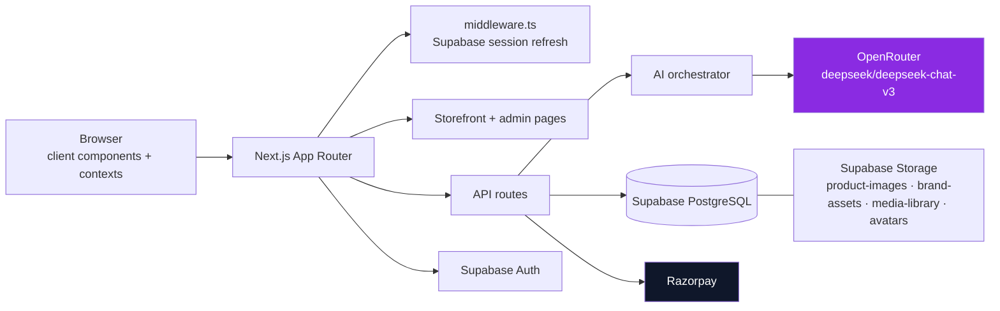
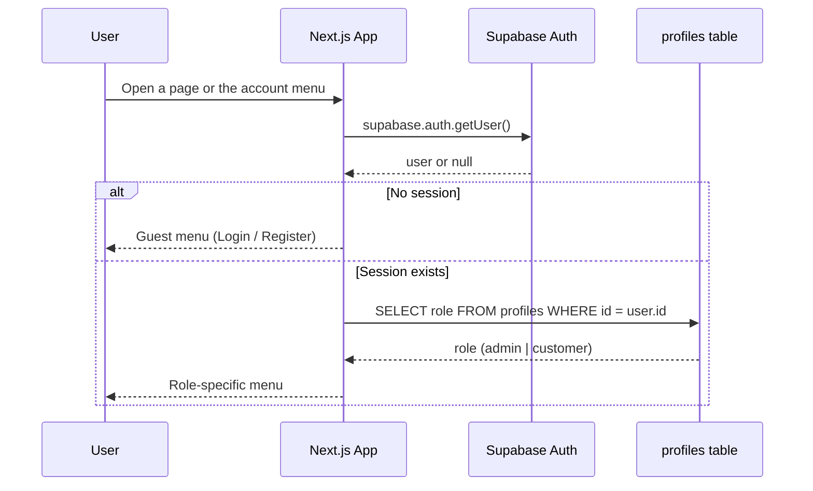
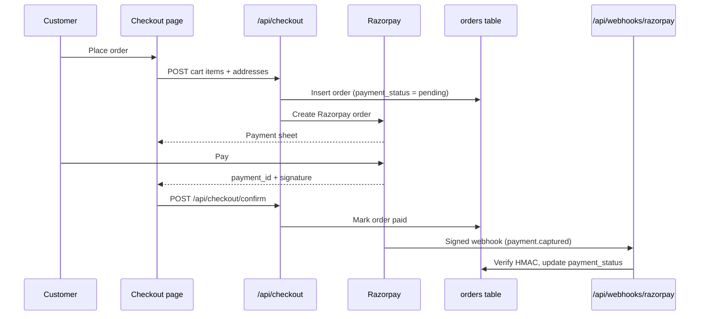
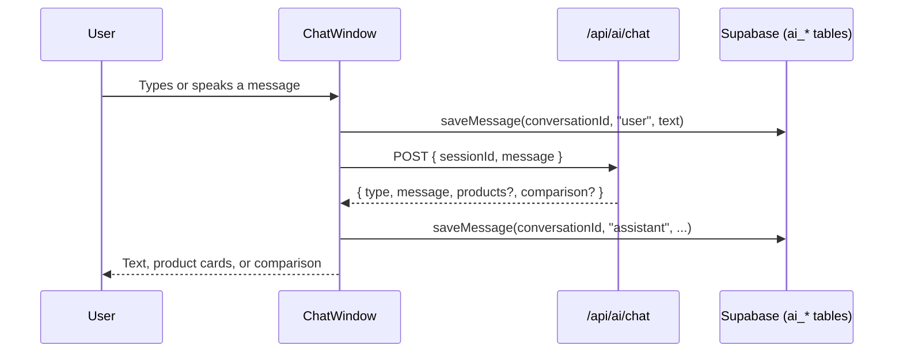
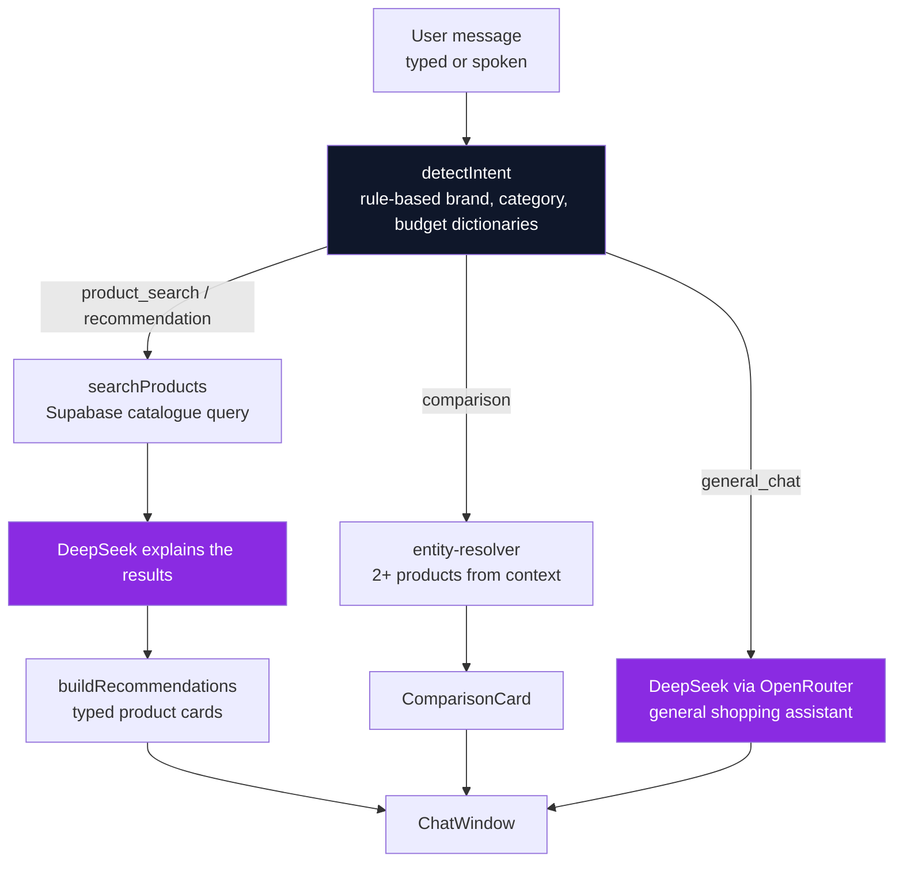
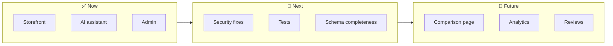

<div align="center">


<a href="https://ai-integrated-personalized-shopping-platform-ium5921jz.vercel.app/">
  
</a>

<br/>

[](https://nextjs.org/)
[](https://react.dev/)
[](https://www.typescriptlang.org/)
[](https://supabase.com/)
[](https://tailwindcss.com/)
[](https://openrouter.ai/)
[](./LICENSE)

**[🌐 Live Demo](https://ai-integrated-personalized-shopping-platform-ium5921jz.vercel.app/)** &nbsp;·&nbsp; **[📂 Source Code](https://github.com/Crusty-chirayu/AI-integrated-Personalized-shopping-platform-)** &nbsp;·&nbsp; **[🎬 Promo Video](./brag-output/brag.mp4)**

</div>

> [!NOTE]
> **Honesty first.** Every feature described below is backed by code in this repository. Where something is partial or missing, it's marked with ⚠️ or 🚧 rather than presented as finished. That includes the known security gaps listed under [Known Limitations](#-known-limitations).

---

## 🎬 Demo

<div align="center">

<a href="./brag-output/brag.mp4">
  
</a>

<br/>

**[▶ Watch the full 20-second promo (1080p)](./brag-output/brag.mp4)**

*Landing page → AI shopping assistant → brand end card.*

</div>

---

## 🔑 Legend

| Symbol | Meaning |
|:---:|---|
| ✅ | Implemented and confirmed in the codebase |
| ⚠️ | Implemented, but with a known gap (see notes) |
| 🚧 | Planned or not yet built |

---

## 📚 Table of Contents

- [About CartIQ](#-about-cartiq)
- [Why CartIQ?](#-why-cartiq)
- [Status Snapshot](#-status-snapshot)
- [Features](#-features)
- [Screenshots](#-screenshots)
- [Architecture](#-architecture)
- [Tech Stack](#-tech-stack)
- [Folder Structure](#-folder-structure)
- [Installation Guide](#-installation-guide)
- [Environment Variables](#-environment-variables)
- [Database Design](#-database-design)
- [Server Actions & API Routes](#-server-actions--api-routes)
- [Security](#-security)
- [Known Limitations](#-known-limitations)
- [AI Architecture](#-ai-architecture)
- [Testing](#-testing)
- [Roadmap](#-roadmap)
- [FAQ](#-faq)
- [Deployment](#-deployment)
- [Contributing](#-contributing)
- [License](#-license)
- [Author](#-author)

---

## 🧭 About CartIQ

**The problem.** Most e-commerce storefronts are search boxes and filter sidebars. The customer does all the work: comparing specs across tabs, guessing which category matches what they actually want, and hunting for the right filter.

**The solution.** CartIQ puts a conversational assistant into the shopping flow. A customer describes what they need in plain language, and the assistant returns matching products from the store's Supabase-backed catalogue, with the same images and prices used everywhere else on the site.

**Mission.** Make product discovery feel like asking a knowledgeable friend, not operating a spreadsheet.

**Scope today.** A full storefront (browse → cart → checkout → orders), a conversational assistant wired to live inventory, and an admin surface for products, orders, customers, and reports.

---

## 💡 Why CartIQ?

Traditional storefronts assume the customer already knows the right search terms. That works for a repeat buyer who knows the exact SKU. It works much less well for someone who knows the *problem* but not the *product name*.

CartIQ's assistant sits in that gap. A customer can type `white sneakers under ₹3,000` and get a real query against the `products` table, with structured results rendered as product cards or a comparison. Follow-up questions reuse the previous category, brand, or budget.

---

## 📊 Status Snapshot

| Area | Status | Notes |
|---|:---:|---|
| 🛍️ Storefront | ✅ | Catalogue, product pages, search, cart, wishlist, compare |
| 🤖 AI Assistant | ✅ | Text and voice input, product results, comparison, saved history |
| 💳 Checkout | ⚠️ | Razorpay order creation and webhook work; confirm route lacks signature check |
| 📦 Orders | ✅ | History, detail page, cancellation, PDF invoice |
| 🛠️ Admin | ✅ | Dashboard, products, orders, customers, reports |
| 🔐 Security | ⚠️ | RLS on 14 tables; several admin routes rely on UI-only checks |
| 🧪 Tests | 🚧 | No automated test suite yet |

---

## ✨ Features

### Customer Features

| Feature | Status | Implementation |
|---|:---:|---|
| Product browsing and detail pages | ✅ | `/products`, `/products/[slug]` |
| Categories | ✅ | `/categories` |
| Search | ✅ | Search modal with a 300 ms debounce, backed by `/api/search` (title, description, category) |
| Cart | ✅ | `cart-context`, persisted to `localStorage` |
| Wishlist | ✅ | `wishlist-context` and `wishlist` table with per-user RLS |
| Product comparison | ✅ | `/compare` page and `ComparisonCard` inside chat responses |
| Checkout | ⚠️ | Razorpay flow at `/api/checkout` and `/api/checkout/confirm`, plus a signed webhook. See [Known Limitations](#-known-limitations) |
| Order history and detail | ✅ | `/orders`, `/orders/[orderId]` |
| Order cancellation | ✅ | Cancel button on the order detail page |
| PDF invoice | ✅ | `Invoice-{order_number}.pdf` generated with jsPDF |
| Role-aware account menu | ✅ | Guest, customer, and admin see different options |
| AI shopping assistant | ✅ | Chat with text or voice input, saved conversations |

### AI Assistant

| Capability | Implementation |
|---|---|
| Natural-language product search | Intent detection routes queries to catalogue search |
| Recommendations | `recommendation-engine` turns search results into product cards |
| Follow-up context | Last category, brand, budget, and selected product are kept per session |
| Product comparison | Triggered when two or more products are resolved from the conversation |
| Add to cart from chat | Cart handler runs when a product is selected and the plan requests it |
| Voice input | Browser Speech Recognition API (`webkitSpeechRecognition`) |
| Saved conversations | Signed-in users' chats stored in `ai_conversations` and `ai_messages` |
| Preference memory | Brand, category, and budget signals saved to `user_preferences` |
| Product-page assistant | `/api/ai/product-chat` returns structured JSON (title, summary, highlights, recommendation) |

### Admin Features

| Feature | Status | Implementation |
|---|:---:|---|
| Dashboard | ✅ | Charts with Recharts |
| Product management | ✅ | Create, edit, delete, and image upload |
| Order management | ✅ | Fulfilment status updated through a Server Action |
| Customers | ✅ | Customer list page |
| Reports | ✅ | PDF exports for sales, orders, inventory, and customers; Excel export for sales |
| Analytics, media, SEO, settings | ✅ | Dedicated admin pages |

### Engineering Highlights

- **Typed end to end.** TypeScript across components, Server Actions, API routes, and Supabase row shapes.
- **Explicit server/client boundary.** Privileged Supabase access lives in `supabase-server.ts`, and browser code uses only the public anon key.
- **Server Actions for privileged writes.** `updateFulfillmentStatus` runs on the server and validates against a fixed status list. Its file exports only async functions, and shared constants live in `fulfillment-status.ts`.
- **Structured assistant output.** Product results are converted into typed card data, and the product-page endpoint constrains the model to a JSON shape.
- **Session-aware routing.** Follow-up questions are resolved against the previous search, so "cheaper ones?" keeps the earlier context.
- **Currency and money helpers.** Shared formatting through `formatCurrency()`.

---

## 🖼️ Screenshots

| Page | Preview |
|---|---|
| Overview |  |
| Home |  |
| Products |  |
| Product Details |  |
| Cart |  |
| Wishlist |  |
| AI Assistant |  |
| Orders |  |
| Account |  |
| Admin Dashboard |  |
| Admin Orders |  |
| Reports |  |
| Analytics |  |
| Mobile |  |

### Promo Frames

<div align="center">

| Hero | AI Assistant | Brand |
|:---:|:---:|:---:|
|  |  |  |

</div>

---

## 🏗️ Architecture

### System Overview



### Authentication Flow



### Checkout Flow



> [!CAUTION]
> The confirm route updates the order without checking the Razorpay signature. The webhook is the verified path. See [Known Limitations](#-known-limitations).

### AI Chat Flow



---

## 🧰 Tech Stack

| Layer | Technology | Purpose |
|---|---|---|
| **Framework** | Next.js 16 (App Router) | Pages, API routes, server components |
| **UI runtime** | React 19 | Client components and interactivity |
| **Language** | TypeScript 5 | Type safety |
| **Styling** | Tailwind CSS 4 | Utility styling via PostCSS |
| **Components** | Radix UI, Lucide, react-icons | Accessible primitives and icons |
| **Animation** | Framer Motion | Transitions and interactive feedback |
| **Data + Auth** | Supabase (`@supabase/ssr`, `supabase-js`) | PostgreSQL, Auth, Storage |
| **AI access** | OpenAI SDK pointed at OpenRouter | Model gateway |
| **Model** | DeepSeek Chat V3 (`deepseek/deepseek-chat-v3`) | Reply generation |
| **Payments** | Razorpay | Checkout and webhooks |
| **Reports** | jsPDF, jspdf-autotable, xlsx | PDF and Excel exports |
| **Charts** | Recharts | Admin dashboard |
| **Markdown** | react-markdown, remark-gfm | Rendering assistant replies |
| **Toasts** | Sonner | Notifications |
| **Package manager** | npm | Lockfile: `package-lock.json` |

---

## 📁 Folder Structure

```text
CartIQ/
├── middleware.ts                    # Supabase session refresh on each request
├── supabase-schema.sql              # Tables and RLS policies
├── supabase-storage-buckets.sql     # Public storage buckets
├── brag-output/brag.mp4             # Promo video
└── src/
    ├── app/
    │   ├── (storefront)/            # Catalogue, cart, checkout, orders, account
    │   ├── admin/                   # Dashboard, products, orders, customers, reports
    │   ├── assistant/               # Conversational shopping page
    │   ├── compare/                 # Product comparison
    │   └── api/
    │       ├── ai/                  # chat, product-chat, conversations, messages
    │       ├── checkout/            # Razorpay order + confirmation
    │       ├── webhooks/            # Razorpay webhook
    │       ├── search/              # Catalogue search
    │       ├── admin/               # Product CRUD + upload
    │       └── reports/             # Sales, orders, customers, inventory
    ├── components/
    │   ├── assistant/               # Chat window, messages, cards, voice input
    │   ├── admin/                   # Product form, charts
    │   └── ui/                      # Shared primitives
    ├── contexts/                    # Auth, cart, wishlist, compare state
    └── lib/
        ├── ai/                      # Orchestrator, intent, search, handlers, prompts
        └── services/                # Product, category, cart, wishlist, storage
```

---

## 🚀 Installation Guide

### Prerequisites

- Node.js 20.9 or newer (required by Next.js 16)
- npm
- A Supabase project
- An OpenRouter API key
- Razorpay test keys (only for checkout)

### Steps

```bash
# 1. Clone the repository
git clone https://github.com/Crusty-chirayu/AI-integrated-Personalized-shopping-platform-.git
cd AI-integrated-Personalized-shopping-platform-

# 2. Install dependencies
npm install

# 3. Create your environment file (see the next section)
#    .env.local

# 4. Set up Supabase (see Database Design)

# 5. Start the dev server
npm run dev
# → http://localhost:3000
```

### Production Build

```bash
npm run build
npm run start
```

### Other Scripts

| Command | Purpose |
|---|---|
| `npm run lint` | ESLint (Next.js core-web-vitals + TypeScript rules) |
| `npx tsc --noEmit` | Type check (no dedicated npm script) |

---

## 🔐 Environment Variables

The repository has no `.env.example`. Create `.env.local` with these names:

| Variable | Used by | Description |
|---|---|---|
| `NEXT_PUBLIC_SUPABASE_URL` | Client, middleware, server | Supabase project URL |
| `NEXT_PUBLIC_SUPABASE_ANON_KEY` | Client, middleware | Public anon key |
| `SUPABASE_SERVICE_ROLE_KEY` | Server only | Bypasses RLS. **Never** expose to the browser |
| `OPENROUTER_API_KEY` | `/api/ai/*`, AI handlers | OpenRouter key |
| `NEXT_PUBLIC_RAZORPAY_PUBLISHABLE_KEY` | Checkout (client) | Razorpay key ID |
| `RAZORPAY_SECRET_KEY` | `/api/checkout` (server) | Razorpay secret |
| `RAZORPAY_WEBHOOK_SECRET` | `/api/webhooks/razorpay` | Verifies webhook signatures |

> [!IMPORTANT]
> `SUPABASE_SERVICE_ROLE_KEY`, `RAZORPAY_SECRET_KEY`, and `RAZORPAY_WEBHOOK_SECRET` must only be read on the server. Keep them out of any file marked `"use client"` and out of version control.

---

## 🗄️ Database Design

Defined in `supabase-schema.sql`. Row Level Security is enabled on 14 of the 15 tables.

| Table | Purpose | RLS |
|---|---|:---:|
| `profiles` | User details and `role` (`customer` or `admin`) | ✅ |
| `products` | Catalogue: title, slug, price, sale price, stock, tags, status | ✅ |
| `product_images` | Ordered images per product | ✅ |
| `categories` | Hierarchical categories (`parent_id`) | ✅ |
| `addresses` | Saved shipping and billing addresses | ✅ |
| `orders` | Order header: totals, addresses, payment and fulfilment status, Razorpay IDs | ✅ |
| `order_items` | Line items with a title snapshot and unit price | ✅ |
| `wishlist` | Per-user product saves, unique per (user, product) | ✅ |
| `reviews` | Ratings (1–5) and review text | ✅ |
| `coupons` | Discount codes with limits and validity | ✅ |
| `hero_slides` | Landing page slides | ✅ |
| `site_settings` | Store name, currency, tax, announcement bar, social links | ✅ |
| `media` | Uploaded file records | ✅ |
| `subscribers` | Newsletter emails | ✅ |
| `contacts` | Contact form submissions | ⚠️ not enabled |

> [!NOTE]
> The AI chat tables (`ai_conversations`, `ai_messages`, `user_preferences`) are queried by the app but are **not** defined in `supabase-schema.sql`. Create them in your Supabase project before using saved chat history.

Storage buckets from `supabase-storage-buckets.sql`: `product-images`, `brand-assets`, `media-library`, `avatars`.

---

## 🔌 Server Actions & API Routes

| Endpoint / Action | Type | Purpose |
|---|---|---|
| `updateFulfillmentStatus(orderId, status)` | Server Action | Updates `orders.fulfillment_status` with the service-role client after validating the status |
| `POST /api/ai/chat` | Route Handler | `{ sessionId, message }` → `{ type, message, products?, comparison? }` |
| `POST /api/ai/product-chat` | Route Handler | Structured JSON assistant reply for one product |
| `GET /api/ai/conversations`, `GET /api/ai/messages` | Route Handler | Chat history reads |
| `GET /api/search?q=` | Route Handler | Catalogue search |
| `POST /api/checkout` | Route Handler | Creates the internal order and the Razorpay order |
| `POST /api/checkout/confirm` | Route Handler | Marks an order paid after the client callback ⚠️ |
| `POST /api/webhooks/razorpay` | Route Handler | Verifies the HMAC signature, then updates payment status |
| `POST /api/admin/products`, `PATCH/DELETE /api/admin/products/[id]` | Route Handler | Product management ⚠️ |
| `POST /api/admin/upload` | Route Handler | Image upload ⚠️ |
| `GET /api/reports/{sales,orders,customers,inventory}` | Route Handler | Report data |
| `POST /api/contact`, `POST /api/newsletter` | Route Handler | Contact form and newsletter signup |
| `POST /api/seed` | Route Handler | Inserts sample products into an empty catalogue |

---

## 🛡️ Security

| Mechanism | Implementation |
|---|---|
| **Session handling** | `middleware.ts` refreshes the Supabase session on each request |
| **Row Level Security** | Enabled on 14 tables. Public read for products, categories, reviews, coupons, and settings. Users manage their own profile, addresses, orders, and wishlist. Admins manage the catalogue, orders, coupons, media, settings, and hero slides |
| **Privileged access** | The service-role client lives in `supabase-server.ts` and is used only on the server |
| **Webhook integrity** | `/api/webhooks/razorpay` verifies an HMAC-SHA256 signature before updating an order |
| **Order scoping** | Order queries filter by the signed-in user's ID and return a not-found state otherwise |
| **Role-based UI** | Admin pages check `profiles.role` and redirect non-admins |

---

## ⚠️ Known Limitations

These were found during a review of the current code. They're listed so nobody mistakes them for protections, and they're the first things I'd fix.

| Issue | Where | Risk |
|---|---|---|
| **Admin API routes don't check the caller's role.** Admin pages are guarded in the browser only. | `/api/admin/products`, `/api/admin/upload`, `/api/reports/*` | Anyone who calls the endpoints directly can change the catalogue |
| **Checkout confirm doesn't verify the signature.** It marks an order as paid from the request body alone. | `/api/checkout/confirm` | An order can be marked paid without a real payment. The webhook is the verified path |
| **Checkout trusts client-supplied prices.** Totals are computed from `unit_price` sent in the request body. | `/api/checkout` | Prices can be lowered before payment |
| **Some assistant intents are placeholders.** | `customer_support`, `shopping_advice` | Returns "Feature coming soon." |
| **Conversation context is in memory.** | `lib/ai/session.ts` (`Map`) | Resets on server restart and isn't shared across instances |
| **Contacts table has no RLS.** | `contacts` | Anyone with the anon key can read it |
| **No automated tests.** | — | Correctness relies on linting and manual checks |

---

## 🧠 AI Architecture

### Pipeline



### What each layer does

| Layer | Module | Responsibility |
|---|---|---|
| **Intent** | `lib/ai/intent.ts` | Classifies `product_search`, `recommendation`, `comparison`, `general_chat`, and others using brand, category, and budget dictionaries |
| **Routing** | `lib/ai/router.ts` | Runs product search for search and recommendation intents |
| **Retrieval** | `lib/ai/product-search.ts` | Queries Supabase products with aliases such as `phone` → `smartphone` |
| **Follow-ups** | `lib/ai/contextual-query.ts`, `lib/ai/session.ts` | Rewrites follow-up messages using the last topic |
| **Orchestration** | `lib/ai/orchestrator.ts` | Coordinates routing, planning, entity resolution, and handlers |
| **Handlers** | `lib/ai/handlers/*` | Product replies, general chat, add-to-cart |
| **Persistence** | `lib/ai/conversation-service.ts`, `memory-service.ts` | Saves chats and preferences for signed-in users |

### Deterministic vs. model-generated

| Deterministic (no model) | Model-generated (DeepSeek) |
|---|---|
| Intent classification | Explaining why search results fit |
| Catalogue retrieval | General shopping answers |
| Follow-up context | Product-page summaries (`/api/ai/product-chat`) |
| Card and comparison data | |

Product data always comes from the database. The model receives retrieved products as input, so it explains results rather than recalling inventory.

> [!TIP]
> `lib/ai/tool-planner.ts` exists in the repository but isn't called by the current pipeline, so it doesn't count as a feature.

---

## 🧪 Testing

| Type | Status |
|---|:---:|
| Unit tests | 🚧 None |
| Integration tests | 🚧 None |
| End-to-end tests | 🚧 None |
| Linting | ✅ `npm run lint` |
| Type checking | ✅ `npx tsc --noEmit` |
| Manual intent check | `src/test.ts` calls `detectIntent` on sample messages. It is a script, not a test runner |

---

## 🗺️ Roadmap

### ✅ Shipped

- [x] Storefront: browse, search, cart, wishlist, compare
- [x] AI assistant with voice input, product cards, comparison, and saved history
- [x] Orders with cancellation and PDF invoice
- [x] Admin dashboard, product management, and order fulfilment
- [x] Admin reports (PDF for four types, Excel for sales)
- [x] Razorpay order creation and signed webhook

### 🚧 Next

- [ ] Verify Razorpay signature in the confirm route
- [ ] Server-side role checks on every admin API route
- [ ] Look up prices from the database during checkout
- [ ] Enable RLS on the `contacts` table
- [ ] Add the AI chat tables to `supabase-schema.sql`
- [ ] Add automated tests

### 🔭 Future

- [ ] Standalone product comparison beyond the chat
- [ ] Customer analytics (spend and order trends)
- [ ] Reviews and ratings on product pages
- [ ] Assistant flows for customer support and shopping advice



---

## ❓ FAQ

**Is CartIQ production-ready?**
Not yet. The core commerce and AI flows work, but the [Known Limitations](#-known-limitations) around admin authorization and payment confirmation should be fixed before it handles real money or real customer data.

**What AI model does it use?**
DeepSeek Chat V3, called through OpenRouter, behind an intent-detection and routing layer. See [AI Architecture](#-ai-architecture).

**Is the AI a full autonomous shopping agent?**
No. It handles conversational discovery, comparison, follow-ups, and light preference memory. It doesn't make purchasing decisions on its own.

**Can I use this as a template for my own store?**
Yes, with the caveat above. Treat the security items as required work before you use it with real payments.

**Why Supabase instead of a custom backend?**
Postgres, Auth, and Storage in one provider, with Row Level Security for the database layer.

---

## ☁️ Deployment

The app is deployed on Vercel:

**https://ai-integrated-personalized-shopping-platform-ium5921jz.vercel.app/**

The repository has no `vercel.json`, so hosting settings come from the Vercel project. Add these environment variables there:

- `NEXT_PUBLIC_SUPABASE_URL`
- `NEXT_PUBLIC_SUPABASE_ANON_KEY`
- `SUPABASE_SERVICE_ROLE_KEY`
- `OPENROUTER_API_KEY`
- `NEXT_PUBLIC_RAZORPAY_PUBLISHABLE_KEY`
- `RAZORPAY_SECRET_KEY`
- `RAZORPAY_WEBHOOK_SECRET`

---

## 🤝 Contributing

Contributions are welcome.

1. Fork the repository and create a feature branch.
2. Keep pull requests focused on one change.
3. In a file marked `"use server"`, export only async functions. Put shared constants and types in a separate module, as `admin/orders/fulfillment-status.ts` does.
4. If a change ships something listed as 🚧 here, update this README.
5. Open a pull request that explains what changed and why.

---

## 📄 License

Released under the **MIT License**. See [`LICENSE`](./LICENSE).

---

## 👤 Author

**Chirayu Babu Jaysawal**

🌐 [Portfolio](https://portfolio-lac-kappa-49.vercel.app) · 💼 [LinkedIn](https://linkedin.com/in/chirayu-babu-jaysawal) · 💻 [GitHub](https://github.com/Crusty-chirayu)

---

## 🙏 Acknowledgements

- [Next.js](https://nextjs.org/): application framework
- [Supabase](https://supabase.com/): database, auth, and storage
- [OpenRouter](https://openrouter.ai/) and [DeepSeek](https://www.deepseek.com/): model access
- [Tailwind CSS](https://tailwindcss.com/): styling
- [Framer Motion](https://www.framer.com/motion/): animation
- [Lucide](https://lucide.dev/): icons
- [jsPDF](https://github.com/parallax/jsPDF) and [jspdf-autotable](https://github.com/simonbengtsson/jsPDF-AutoTable): PDF generation

---

<div align="center">

**If CartIQ is useful to you, consider starring the repo ⭐**


</div>
