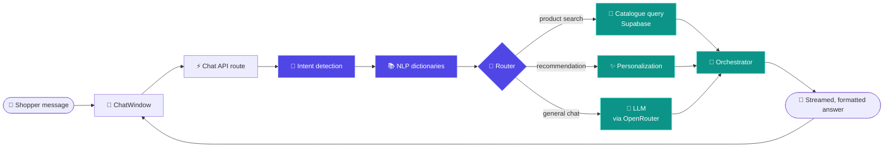
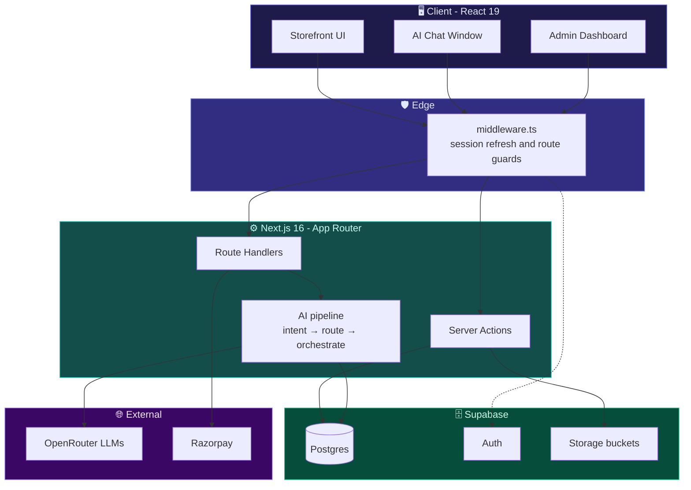

<div align="center">



<br/>

[](https://ai-integrated-personalized-shopping-platform-ium5921jz.vercel.app/)
[](https://nextjs.org/)
[](https://www.typescriptlang.org/)
[](https://supabase.com/)
[](./LICENSE)

[](https://github.com/Crusty-chirayu/CartIQ/stargazers)
[](https://github.com/Crusty-chirayu/CartIQ/network/members)
[](https://github.com/Crusty-chirayu/CartIQ/issues)
[](https://github.com/Crusty-chirayu/CartIQ/commits/main)
[](https://github.com/Crusty-chirayu/CartIQ)
[](#-contributing)

### Stop searching. Start talking.

**CartIQ is an AI-native e-commerce platform where shoppers find products by *conversation*, not filters, and store owners run everything from a single admin dashboard.**

[**Live Demo**](https://ai-integrated-personalized-shopping-platform-ium5921jz.vercel.app/) &nbsp;•&nbsp; [**Features**](#-features) &nbsp;•&nbsp; [**How the AI Works**](#-how-the-ai-works) &nbsp;•&nbsp; [**Quick Start**](#-quick-start) &nbsp;•&nbsp; [**Architecture**](#-architecture) &nbsp;•&nbsp; [**Roadmap**](#-roadmap)


</div>

<br/>

## ✨ The Pitch

Traditional online stores make you work: pick a category, tick five filters, sort, scroll, repeat. **CartIQ flips that.** Tell it what you need in plain language, such as *"a laptop for coding under 70,000"*, and it understands intent, searches the catalogue, and brings back ranked matches. Then it keeps the conversation going: compare, refine, add to cart.

Behind the storefront sits a complete **admin dashboard** for orders, inventory and reports, so it is not just a chatbot demo. It is a full shop, end to end.

<div align="center">



</div>

<br/>


## 🚀 Features

<table>
<tr>
<td width="33%" valign="top">

### 🛍️ Storefront
- Responsive, premium indigo-to-teal UI
- Product browsing and detail pages
- Cart and checkout flow
- Razorpay payment integration
- Smooth Framer Motion transitions
- Toast feedback via Sonner

</td>
<td width="33%" valign="top">

### 🤖 AI Concierge
- **Conversational product search**
- Intent detection and NLP routing
- **Personalized recommendations**
- Markdown-rich chat responses
- Syntax-highlighted code blocks in replies
- Multi-model backend via OpenRouter

</td>
<td width="33%" valign="top">

### 📊 Admin Dashboard
- Order management
- Inventory control
- Analytics charts (Recharts)
- **Exportable reports** (PDF and Excel)
- Product image uploads (Supabase Storage)
- Role-protected routes via middleware

</td>
</tr>
</table>

<details>
<summary><b>🔍 See the full feature breakdown</b></summary>

<br/>

| Area | What you get |
|---|---|
| **Search** | Natural-language queries understood by an intent layer rather than keyword matching alone |
| **Recommendations** | Personalized suggestions surfaced in the chat and across the storefront |
| **Auth** | Supabase Auth with server-side session handling (`@supabase/ssr`) |
| **Data layer** | Postgres on Supabase, schema shipped as plain SQL for one-step setup |
| **Server logic** | Next.js App Router with Server Actions for mutations |
| **Payments** | Razorpay order creation and verification |
| **Reporting** | Client-side PDF (`jsPDF` + `autotable`) and spreadsheet (`xlsx`) generation |
| **Design system** | Tailwind CSS v4, Radix UI primitives, `class-variance-authority`, `lucide-react` icons |
| **Feedback** | Toasts, progress, dialogs, popovers, tooltips, and tabs, all accessible by default through Radix |

</details>

<br/>


## 🧠 How the AI Works

CartIQ does not just forward your message to a language model. A purpose-built backend pipeline **detects intent first, routes second, and only then orchestrates the model and the database**, so answers are grounded in the real catalogue.



**The idea in one line:** classify what the shopper *means*, fetch real data for it, then let the model phrase the result. The model talks, but the database tells the truth.

<br/>


## 🏗️ Architecture



<br/>


## 🧰 Tech Stack

<div align="center">


</div>

<br/>

| Layer | Technology |
|---|---|
| **Framework** | Next.js 16 (App Router, Server Actions, Middleware) |
| **UI** | React 19, Tailwind CSS v4, Radix UI, Framer Motion, Lucide and React Icons |
| **Language** | TypeScript 5 (strict typing end to end) |
| **Backend and DB** | Supabase (Postgres, Auth, Storage) with `@supabase/ssr` |
| **AI** | OpenRouter-routed LLMs (DeepSeek), OpenAI SDK, Google Generative AI SDK |
| **Chat rendering** | `react-markdown`, `remark-gfm`, `rehype-highlight`, `highlight.js` |
| **Payments** | Razorpay |
| **Charts and reports** | Recharts, jsPDF, jsPDF-AutoTable, SheetJS (`xlsx`) |
| **Tooling** | ESLint 9, PostCSS, Vercel |

<br/>


## ⚡ Quick Start

### Prerequisites

- **Node.js** 20 or newer
- **npm** (or pnpm / yarn)
- A free **[Supabase](https://supabase.com/)** project
- An **[OpenRouter](https://openrouter.ai/)** API key
- *(Optional)* **[Razorpay](https://razorpay.com/)** test keys for checkout

### 1. Clone and install

```bash
git clone https://github.com/Crusty-chirayu/CartIQ.git
cd CartIQ
npm install
```

### 2. Configure environment

Create a `.env.local` file in the project root:

```env
# Supabase
NEXT_PUBLIC_SUPABASE_URL=https://your-project.supabase.co
NEXT_PUBLIC_SUPABASE_ANON_KEY=your-anon-key
SUPABASE_SERVICE_ROLE_KEY=your-service-role-key   # server only, never expose

# AI
OPENROUTER_API_KEY=your-openrouter-key

# Payments (optional)
RAZORPAY_KEY_ID=your-key-id
RAZORPAY_KEY_SECRET=your-key-secret
```

> [!IMPORTANT]
> Never commit `.env.local`. The service-role key bypasses Row Level Security and must stay on the server.

### 3. Set up the database

Open the **SQL Editor** in your Supabase dashboard and run these two files, in order:

| Order | File | Purpose |
|:--:|---|---|
| 1 | [`supabase-schema.sql`](./supabase-schema.sql) | Creates tables, relations and policies |
| 2 | [`supabase-storage-buckets.sql`](./supabase-storage-buckets.sql) | Creates storage buckets for product images |

### 4. Run it

```bash
npm run dev
```

Open **http://localhost:3000** and start chatting with your store.

### Useful scripts

| Command | What it does |
|---|---|
| `npm run dev` | Start the dev server with hot reload |
| `npm run build` | Create an optimized production build |
| `npm run start` | Serve the production build |
| `npm run lint` | Lint the codebase with ESLint |

<br/>


## 🗂️ Project Structure

```text
CartIQ/
├── src/                      # Application source (App Router, components, AI pipeline)
├── public/                   # Static assets
├── readme-assets/            # Animated SVGs used by this README
├── middleware.ts             # Session refresh and route protection
├── next.config.ts            # Next.js configuration
├── supabase-schema.sql       # Database schema
├── supabase-storage-buckets.sql  # Storage bucket setup
├── tailwind / postcss config # Tailwind v4 via @tailwindcss/postcss
├── eslint.config.mjs         # Lint rules
├── tsconfig.json             # TypeScript config
└── LICENSE                   # MIT
```

<br/>

## 🔐 Security Notes

- **Route protection** runs in `middleware.ts`, so unauthenticated users never reach protected pages.
- **Secrets stay server-side.** Only `NEXT_PUBLIC_*` variables are exposed to the browser.
- **Auth is delegated** to Supabase Auth with cookie-based server sessions.
- **Payments are verified on the server**, never trusted from the client.

<br/>

## 🗺️ Roadmap

- [x] Conversational product search
- [x] Personalized recommendations
- [x] Admin dashboard for orders, inventory and reports
- [x] PDF and Excel report export
- [x] Razorpay checkout
- [x] Premium indigo-to-teal UI redesign
- [ ] Voice-driven shopping
- [ ] Image-based product search
- [ ] Multi-language chat
- [ ] Wishlist and price-drop alerts
- [ ] Automated test suite and CI pipeline

Have an idea? [Open an issue](https://github.com/Crusty-chirayu/CartIQ/issues), because the best features start as conversations.

<br/>


## 🤝 Contributing

Contributions make open source great. To get started:

```bash
# 1. Fork the repo, then
git checkout -b feature/amazing-idea

# 2. Make your changes and commit
git commit -m "feat: add amazing idea"

# 3. Push and open a Pull Request
git push origin feature/amazing-idea
```

Please run `npm run lint` before opening a PR, and keep commits focused.

<br/>

## 📄 License

Released under the **[MIT License](./LICENSE)**. Use it, learn from it, build on it.

<br/>

## 👨‍💻 Author

<div align="center">

### **Chirayu**
*Computer Engineering student · full-stack builder · AI tinkerer*

[](https://github.com/Crusty-chirayu)
[](https://www.linkedin.com/in/chirayu-jayaswal)
[](https://portfolio-lac-kappa-49.vercel.app)

<br/>

**If CartIQ helped or inspired you, drop a ⭐. It genuinely makes my day.**

<a href="https://star-history.com/#Crusty-chirayu/CartIQ&Date">
  
</a>

<br/><br/>


<sub>Built with ☕, TypeScript and an unreasonable amount of gradient. &nbsp;·&nbsp; <a href="#">Back to top ↑</a></sub>

</div>
